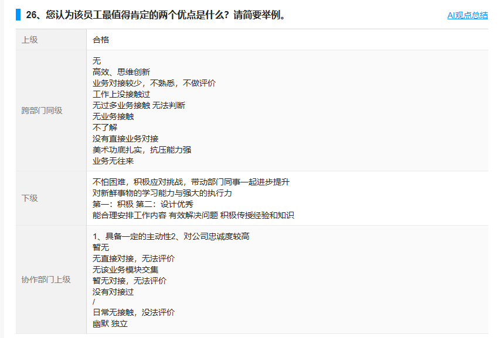

# 功能沟通清单

## 🧩 功能沟通清单（分6大模块）

### 模块一：组织架构与人员管理（底层数据）

业务描述：系统需要知道公司有哪些人、什么部门、什么岗位。

具体功能点：

> 💡 这是基础数据源，后续所有评估关系都依赖这里的“岗位”字段去匹配问卷。
> 
> 

### 模块二：问卷与维度管理（题库建设）

业务描述：HR需要为不同岗位创建差异化的评估问卷（含维度和题目）。

具体功能点：

> 💡 工程师：一个问卷 = 1个岗位；一个问卷下有N个维度；一个维度下有N道题\-分值。
> 
> 

**问卷星   示例：**

- 选项对应分值，共6个选项，0分不计分；

- 每个选项可选择文本题，便于写该选项的评语；

- 此题可分配对应关系，勾选只分配的关系后，其他关系不可见；

- 一页一题，展示简洁，便于评价分打分。

### 模块三：评估项目与关系配置（最复杂）

业务描述：HR创建一次评估活动（如“2026年11月管理层360”），并设定谁评谁、权重多少。

评估项目点击开只显示问卷数量和问卷列表，项目基本情况。点击问卷后显示填写详情，哪些人填了、哪些人没填。

具体功能点：

> ⚠️ 特别提醒：权重配置可以设置自定义配置，给到HR配置权限即可
> 
> 

**问卷星  示例：**

- 评估关系设定时，可添加被评者、关系级别、具体评价者；

- 有误的设定，允许“修改”与“新增评价关系”；

- 允许不同关系的“权重设置”。

### 模块四：评估发送与填写（核心业务流程）

业务描述：管理员一键发送，员工收到通知并填写。

具体功能点：

### 模块五：自动催办与截止管理（解放HR双手）

业务描述：系统自动提醒未填写的人，并在截止后锁定。

具体功能点：

### 模块六：数据回收与报表导出（最终交付物）

业务描述：HR下载数据，进行统计分析。

具体功能点：

**问卷星  示例（以下均可下载到本地）：**

1、题目得分

2、选项文本\-主观评价展示

3、开放性题目评价展示

4、个人报告得分

5、导出的数据的格式 可以选择：

- 按分数下载

## 🔧 必须跟工程师对齐的“技术约束与坑”

> 核心逻辑一句话总结：管理员导入评价关系 → 配置岗位问卷和权重 → 一键发飞书通知 → 员工填表（漏题禁交） → 系统自动催办 → 截止后导出汇总Excel和个人Excel。
> 
> 

---

最后叮嘱：“权重要求和=100%”、“唯一索引防重复”🚀

